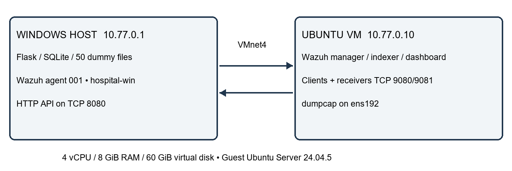

# Healthcare SOC Lab


A reproducible hospital security lab that generates real network traffic, application audit events, and filesystem changes — then uses [Wazuh](https://wazuh.com/) to detect four controlled attack scenarios against a synthetic hospital IT system.

> **No real patient data, real malware, or production systems are involved.** The hospital is a fully synthetic Python/Flask API backed by SQLite.

---

## What it does

Normal clinical workflows (record reads, lab orders, device telemetry, document edits, approved exports) run continuously as a baseline. Four attack scenarios are then executed against the same live API, and a strict automated evaluator verifies that every piece of evidence — application logs, Wazuh archives, alerts, packet captures, and SHA-256 file hashes — is consistent and complete.

### Attack scenarios

| ID | Name | What happens | Rules fired |
|---|---|---|---|
| S1 | Account misuse & suspicious EMR access | 6 failed logins then 30 off-assignment patient record reads | `110101` `110102` `110103` |
| S2 | Ransomware-like document tampering | All 50 dummy clinical documents overwritten; before/after SHA-256 tracked | `110201` |
| S3 | Unauthorised data exfiltration | 5 MB synthetic patient bundle POSTed to an unapproved receiver | `110301` `110302` |
| S4 | Privilege escalation probe | Nurse account repeatedly attempts clinician-only and administrator-only routes | `110401` |

---

## Architecture



Two machines on an isolated VMware host-only network (`VMnet4`, `10.77.0.0/24`):

**Windows host — `10.77.0.1`**
- Hospital Flask API on TCP 8080 with SQLite (200 synthetic patients, 10 devices, 50 dummy documents)
- Structured append-only audit log (`logs/app.jsonl`)
- Wazuh agent `hospital-win` — log collection + File Integrity Monitoring on the documents directory

**Ubuntu VM — `10.77.0.10`**
- Wazuh 4.14.10 all-in-one (manager + OpenSearch indexer + dashboard)
- Two lab receivers on TCP 9080 (unapproved) and 9081 (approved)
- `dumpcap`/`tshark` capturing all lab traffic on `ens192`

See [docs/architecture.md](docs/architecture.md) for a full component walkthrough.

---

## Project structure

```
src/hospital_soc/     Python package — Flask API, scenario runner, evaluator
siem/                 Custom Wazuh rules, OpenSearch queries, dashboard NDJSON
scripts/              Setup, capture, timing, and reporting utilities
tests/                pytest suite (196+ tests)
docs/                 Operator handoff, clean-rebuild guide, design spec
report/               Final report and evidence index
config/               lab.example.json — copy to lab.local.json and edit
```

---

## Getting started

### Prerequisites

- Python 3.12+
- VMware Workstation (for the full two-machine lab)
- Wazuh 4.14.10 on the Ubuntu VM (see [docs/operator-handoff.md](docs/operator-handoff.md))

### Local development (VM off)

```powershell
python -m venv .venv
.venv\Scripts\pip install -e ".[test]"
.venv\Scripts\pytest -q
```

### Full loopback smoke test

Seeds the runtime, runs baseline + all four scenarios, restores documents, and reports whether each run evaluates correctly:

```powershell
.venv\Scripts\python scripts\run-local-validation.py
```

Diagnostic sleeps are skipped in loopback mode. The evaluator will correctly report these runs `incomplete` (native Wazuh evidence is absent by design).

### Live lab run

With the Ubuntu VM running and the Wazuh agent active:

```bash
# On Ubuntu VM — start receivers and packet capture, run a scenario, collect evidence
bash scripts/run-lab-scenario.sh s1
```

See [docs/operator-handoff.md](docs/operator-handoff.md) for the full setup procedure including agent config, FIM configuration, and evidence collection.

---

## Detection rules

Thirteen custom Wazuh rules in the `110000` range (`siem/healthcare_rules.xml`):

| Rule | Level | Description |
|---|---|---|
| `110000` | 0 | Base classifier — any `hospital-lab` JSON event |
| `110001` | 1 | Authentication failure |
| `110101` | 10 | Repeated auth failures (≥5 in 60 s, same actor) |
| `110002` | 1 | Patient record read |
| `110102` | 8 | Record read outside care assignment |
| `110103` | 10 | High-volume record reads (≥20 in 60 s) |
| `110003` | 1 | Document updated |
| `110201` | 12 | High-volume document updates (≥20 in 60 s) |
| `110004` | 1 | Export completed |
| `110301` | 8 | Export to unapproved destination |
| `110302` | 12 | Large export to unapproved destination (≥1 MB) |
| `110005` | 1 | Request rejected by role enforcement |
| `110401` | 10 | Repeated role-enforcement rejections — privilege escalation probe (≥5 in 120 s) |

---

## Evidence verification

The evaluator (`hospital-soc evaluate --run-dir <path>`) gates each run as `complete`, `incomplete`, or `invalid`. It cross-checks:

- 100% source event → Wazuh archive coverage, no duplicates, timestamps within bounds
- Alert reconciliation: each actionable alert matched back to a source event by UUID, latency ≤ 30 s
- Clock drift ≤ 1000 ms, index visibility delay ≤ 60 s, zero dropped packets
- 65-second quiet interval between runs
- 26 Wazuh logtest boundary cases (native rule proof, schema 3)
- Packet evidence cross-checked via `tshark` with scenario-specific request counts
- S2: SHA-256 before/after inventory + FIM digest corroboration for all 50 documents
- S4: 13 `request_rejected` audit events all attributed to the probing actor

---

## Verification status

| Check | Result |
|---|---|
| pytest suite | **196 passing tests + 6 subtests** |
| Wazuh native rule suite | **26/26 PASSED** (schema 3) |
| Observed scenario runs | **14/14 evaluated `complete`** |
| tshark compatibility | Verified on 4.2.2 (Ubuntu) and 4.6.9 (Windows) |

---

## Policy modes

The hospital API runs in one of two modes (set via `--policy` or `config/lab.local.json`):

- **`observe`** (default) — off-assignment reads and unapproved exports are permitted and audited. Used for measured attack scenario runs.
- **`enforce`** — the same actions are denied with HTTP 403 before they complete. Used to demonstrate mitigations.

---

## Disclaimer

This is a synthetic university security lab. It does not implement HL7/FHIR/DICOM, does not use production network segmentation, and makes no clinical-safety or compliance claims. See [SECURITY.md](SECURITY.md) for responsible disclosure information.
