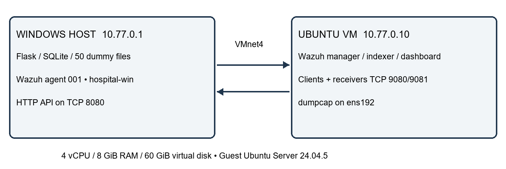

# Architecture



## Overview

The lab runs across two machines on an isolated VMware host-only network (`VMnet4`, `10.77.0.0/24`). No internet access is used during runs. The Windows host runs the synthetic hospital; the Ubuntu VM runs the full Wazuh SIEM stack and captures all traffic.

---

## Windows host — `10.77.0.1`

### Hospital Flask API (`src/hospital_soc/`)

The API serves as the synthetic hospital's IT system. It is a standard Flask application with five blueprints:

| Blueprint | Routes | Purpose |
|---|---|---|
| `auth` | `POST /api/auth/login` | Session token issuance, password check via werkzeug |
| `clinical` | `GET /api/records/<id>`, `POST /api/lab/orders`, `POST /api/lab/results`, `POST /api/devices/<id>/telemetry` | Patient records, lab workflow, device heartbeats |
| `documents` | `GET /api/documents/hashes`, `PUT /api/documents/<id>` | Document inventory and update (SHA-256 tracked) |
| `exports` | `POST /api/exports` | Synthetic payload builder and cross-host receiver client |
| _(app)_ | `GET /health` | Clock, policy mode, database liveness |

Every request gets two UUID correlation headers (`X-Lab-Run-ID`, `X-Request-ID`). Every response produces one structured JSON audit event appended to `logs/app.jsonl`.

### SQLite database

Seeded with:
- 200 synthetic patients across three wards (ward-a, ward-b, ward-c)
- 7 user accounts (clinician, nurse, lab-technician, records-clerk, document-editor, administrator, lab-service)
- 10 device identities
- Care assignments: clinician and nurse are assigned to patients P0001–P0067 (ward-a only)

### Documents directory

50 dummy files (`documents/D001.txt`–`D050.txt`), each 1 KB. Used in scenario S2. SHA-256 hashes are tracked by both the application and Wazuh FIM independently.

### Wazuh agent `hospital-win`

Configured via `siem/agent-localfile.xml` and `siem/agent-fim.xml`:
- **Log collection**: reads `logs/app.jsonl` as a JSON log source, forwarding each line to the Wazuh manager
- **File Integrity Monitoring**: monitors `documents/` for content changes, recording `sha256_before` and `sha256_after` per file

---

## Ubuntu VM — `10.77.0.10`

### Wazuh 4.14.10 all-in-one

Three services on the VM:

| Service | Role |
|---|---|
| `wazuh-manager` | Receives agent events, runs custom rules (`siem/healthcare_rules.xml`), writes archives and alerts |
| `wazuh-indexer` (OpenSearch) | Indexes archives (`wazuh-archives-*`) and alerts (`wazuh-alerts-*`) |
| `wazuh-dashboard` | Kibana-compatible dashboard — 8-panel view generated from `siem/dashboard.ndjson` |

### Lab receivers

Two minimal Flask apps (`src/hospital_soc/receiver.py`) listening on:
- TCP **9080** — `unapproved-lab` destination (used in S3)
- TCP **9081** — `approved-lab` destination (used in baseline)

Each receiver validates an HMAC key, UUID transfer ID, and SHA-256 digest; stores the payload as `<transfer_id>.bin`; and appends a receipt to `receiver.jsonl`.

### Packet capture

`dumpcap` runs on `ens192` for the duration of each scenario, producing `traffic.pcapng`. After the run, `tshark` exports a CSV of HTTP fields (`frames.csv`) used by the evaluator to independently verify cross-host request counts and correlate run UUIDs.

---

## Data flow

```
Scenario runner (Ubuntu)
        │  HTTP + X-Lab-Run-ID header
        ▼
Hospital API (Windows :8080)
        │  append JSON line
        ▼
logs/app.jsonl  ──►  Wazuh agent (filebeat)  ──►  Wazuh manager (Ubuntu)
                                                          │
                              ┌───────────────────────────┤
                              │                           │
                     Custom rules eval            OpenSearch index
                     (healthcare_rules.xml)       wazuh-archives-*
                              │                   wazuh-alerts-*
                     Alerts on match                      │
                                                   Dashboard / queries
```

For S2, Wazuh FIM independently detects each document write and produces syscheck alerts with `sha256_before`/`sha256_after`, which the evaluator cross-checks against the application's own inventory responses.

For S3, the receiver on the Ubuntu VM stores the received binary and appends a receipt to `receiver.jsonl`, which the evaluator verifies against the application audit event's `bytes_sent`, `payload_sha256`, and `transfer_id`.

---

## Policy modes

The hospital API enforces one of two modes at startup:

| Mode | Off-assignment record reads | Unapproved exports | Used for |
|---|---|---|---|
| `observe` | 200 OK (audited) | 200 OK (audited) | Measured attack scenario runs |
| `enforce` | 403 Forbidden | 403 Forbidden | Mitigation demonstration |

Policy mode is reported by `GET /health` and recorded in every run manifest.

---

## Key design decisions

**Why a synthetic API instead of real EMR software?** A synthetic API gives complete control over audit event structure, deterministic seeding, and reproducible scenarios. The goal is detection engineering, not EMR emulation.

**Why SQLite?** The lab runs on a single host-only network with one concurrent user. SQLite eliminates a dependency and keeps the runtime self-contained.

**Why SHA-256 tracking in both the application and Wazuh FIM?** The two channels are entirely independent — the application reads file content through the Python `hashlib` library; Wazuh FIM reads the same files through the OS. Agreement between them provides strong corroboration that the evidence is genuine and unmanipulated.

**Why an isolated network?** The lab generates realistic attack traffic. An isolated `VMnet4` network ensures no traffic leaks and no interference from the host machine's real network.
